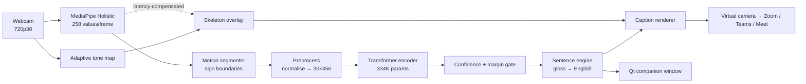

# SignSync

**Real-time American Sign Language → English captioning for video calls.**

SignSync watches your webcam, recognises ASL signs as you make them, turns them
into English sentences, and republishes your video (with live captions and a
hand-tracking overlay drawn in) as a **virtual webcam** that Zoom, Teams or
Meet can select. It needs no host permission, no meeting plugin and no cloud
service. Everything runs locally on a laptop CPU.

<p>
  
  
  
  
  
  
</p>

| | |
|---|---|
| **Task** | Isolated sign recognition (50 classes) → gloss-to-English → live video captions |
| **Model** | 2-layer Transformer encoder over pose/hand landmarks, **334K parameters** |
| **Accuracy** | **81.0% top-1 / 93.7% top-5** (leakage-controlled split) · **~41%** on signers never seen in training |
| **Latency** | Video at 30 fps, recognition at ~23 fps on CPU, with a three-thread pipeline |
| **Data** | 1,513 sequences: 1,013 WLASL clips from 64 signers + 500 self-recorded takes |

---

## Contents

- [At a glance (for reviewers)](#at-a-glance-for-reviewers)
- [Why this exists](#why-this-exists)
- [Pipeline](#pipeline)
- [Results](#results)
- [Using SignSync](#using-signsync)
- [Training it yourself](#training-it-yourself)
- [Engineering notes](#engineering-notes)
- [Repository layout](#repository-layout)
- [Tech stack](#tech-stack)
- [Limitations and roadmap](#limitations-and-roadmap)
- [Acknowledgements](#acknowledgements)

---

## At a glance (for reviewers)

This project covers the whole ML lifecycle: data acquisition, feature
engineering, model selection, evaluation design, and deployment into a
real-time product. The parts I'd point to first:

- **Evaluation that doesn't flatter the model.** A random split leaks
  near-duplicate takes recorded in one sitting into validation. I report a
  *grouped* split and a *signer-disjoint* cross-validation side by side, and
  treat the gap between them (81% vs ~41%) as the main finding.
- **Train/serve parity by construction.** One preprocessing module
  ([`src/features.py`](src/features.py)) is imported by training, evaluation
  and live inference, because a mismatch there fails silently.
- **Data-driven feature engineering.** Each preprocessing step was justified by
  a measurement: leg landmarks with 0.045 mean visibility were dropped, missing
  hands are kept at zero instead of being "centred" into fake positions, and
  clips are resampled instead of truncated (see the [table below](#2-preprocessing-one-definition-shared-everywhere)).
- **A modelling problem solved with system design.** A closed-set classifier
  with no "not a sign" class gives confident wrong answers between signs. The
  fix is a motion segmenter that scores each sign once, not a tuned threshold.
- **Ablations, not guesses.** [`src/sweep.py`](src/sweep.py) runs a
  capacity/regularisation sweep under signer-disjoint CV, logged to Weights &
  Biases, and chooses on validation accuracy *and* the train/val gap.
- **Profiled real-time engineering.** Every frame-budget decision (threading,
  caption caching, 720p publishing, BGR pass-through) cites a measured
  millisecond cost.

## Why this exists

Deaf and hard-of-hearing people in video meetings usually rely on a human
interpreter, a live captioner, or typing in the chat. These are expensive,
hard to get at short notice, or too slow to keep up with a conversation.

SignSync tries the cheapest possible fallback: **the signer's own laptop does
the interpreting, and the result goes straight into the video feed**, so it
works in any meeting the signer can join. There are no host settings, no
enterprise licence, and no data leaving the machine.

I chose the virtual camera over Zoom's third-party captioning API on purpose.
That API needs the *host* to enable it for each meeting and hand out a token.
Captions drawn into the video need nothing from anyone else.

---

## Pipeline



### 1. Landmarks, not pixels

Each frame becomes 258 floats: 21 left-hand and 21 right-hand landmarks
`(x, y, z)`, plus 33 pose landmarks `(x, y, z, visibility)`. If MediaPipe
loses a hand, its landmarks are **filled with zeros, never dropped**, so the
frame still carries the pose information.

Working with landmarks instead of pixels keeps the model at ~334K parameters
rather than tens of millions. It trains in minutes on a free Colab T4 and is
largely unaffected by clothing, background and skin tone.

### 2. Preprocessing: one definition shared everywhere

[`src/features.py`](src/features.py) is the *only* implementation of the
transform. Training, evaluation and the live app all import it.

| Step | Why (measured) |
|---|---|
| Centre on the torso (mean of the hips), scale by shoulder width | Removes camera distance, so a sign looks the same near or far |
| Keep zeros for undetected hands | Centring an all-zero hand turns it into a *definite position* ~1.9 units away. Hands are missing in 40–80% of frames, so this was corrupting most of the dataset |
| Drop pose landmarks 25–32 (legs and feet) | Mean visibility 0.045, so 12% of every frame was pure noise |
| Append 2 hand-presence flags | Easier to learn than inferring absence from 63 zeroed dimensions |
| Resample to exactly 30 frames | Truncation covered 49% of a 61-frame clip but only 26% of a 117-frame one, so how much of a sign the model saw depended on how fast it was signed |
| Append frame-to-frame velocity | Motion is what separates many sign pairs; feature width goes 228 → 456 |

Final model input: **`(batch, 30, 456)` float32.**

### 3. Model and training

| | |
|---|---|
| Architecture | Transformer encoder, 2 layers, `d_model` 128, 4 heads, sinusoidal positions, mean-pooled |
| Parameters | 333,746 |
| Loss | Focal loss (γ = 1.0) with 0.1 label smoothing, for class imbalance |
| Optimiser | AdamW (lr 1e-3, weight decay 1e-2), cosine annealing |
| Regularisation | Dropout 0.4, class-weighted sampling, optional mixup |
| Augmentation | Gaussian noise, temporal shift, speed jitter, scale jitter, frame dropout |
| Baseline | Bidirectional LSTM, kept in [`model.py`](src/model.py) for comparison |

I tried hand-mirroring augmentation and removed it: it creates signs that
don't exist (WLASL signers are right-dominant) and dropped accuracy to near
chance.

### 4. Segmentation: the interesting problem

The classifier has 50 classes and **no "not a sign" class**, so it labels
whatever it's shown. Running it over a free-sliding window gives confident
nonsense whenever the window spans two signs. I measured **0.965 confidence
with a 0.954 margin** on these, higher than the weakest *real* word
(0.830 / 0.700). No threshold can separate those.

The fix is architectural: **score each detected sign once.**
[`src/segmenter.py`](src/segmenter.py) tracks hand motion against a resting
baseline that only updates *while the hands are at rest*. (An earlier
rolling-median baseline drifted upward during signing and fired as the sign
ended.) It uses hysteresis, entering at 2.0× rest and exiting at 1.5×, so a
pause mid-sign doesn't split it in two. All thresholds are **durations in
seconds, not frame counts**, so behaviour stays the same whether MediaPipe runs
at 15 fps or 30 fps.

### 5. Acceptance gate

A word enters the sentence only if it reaches ≥ 0.75 confidence **and** beats
the runner-up by ≥ 0.25. Repeats and re-fires within the cooldown are dropped.
The UI shows *why* each candidate was rejected, so you can debug the system
live on camera.

### 6. Gloss → English

[`src/sentence_engine.py`](src/sentence_engine.py) is deterministic and
rule-based, so nothing goes over the network during a live call. It tags words
by role (interjection, question, time, verb, adjective, noun) and builds the
sentence from them.

Its governing rule is **render only what was signed.** An earlier version
wrapped the output in "I want to …", adding meaning the signer never
expressed. For a tool whose whole job is faithful interpretation, confidently
adding words is the worst bug it can have. Articles and possessives are left
out rather than guessed. Hand-written glosses for demo phrases
([`demo_phrases.py`](src/demo_phrases.py)) take priority, and a `refine_fn`
hook leaves room for an optional LLM polishing pass.

### 7. Real-time video path

MediaPipe takes ~42.7 ms per frame, which doesn't fit a 30 fps (33.3 ms)
budget, so the app runs on three threads:

| Thread | Job |
|---|---|
| Qt main | UI only; never blocks on video |
| `InferenceWorker` (QThread) | Camera → tone map → skeleton → captions → virtual camera, at 30 fps |
| `DetectorThread` | MediaPipe + segmentation + classification at ~23 fps, dropping frames when behind |

Dropping detection frames is *correct*, not lossy. The segmenter works in
seconds and the capture window is sized from the detector's measured rate.

On the output side:

- **Adaptive tone mapping** ([`tone.py`](src/tone.py)) measures each frame's
  black and white points and the mean brightness, then bakes a levels stretch
  plus an automatic gamma into one 256-entry LUT. This replaced a fixed gamma
  that was either milky or too dark depending on the room (contrast
  67.4 → 77.6, blacks 48 → 21).
- **Latency-compensated skeleton** ([`skeleton.py`](src/skeleton.py),
  [`overlay.py`](src/overlay.py)). Landmarks are 40–90 ms old by the time
  they're drawn, so the overlay uses velocity to extrapolate them forward
  (capped at 100 ms), the way AR overlays hide sensor lag. This is
  **cosmetic only**: the classifier always receives the raw measurements.
- **Broadcast-style captions** ([`caption_render.py`](src/caption_render.py)):
  outlined TrueType text, rasterised once per caption change and blended only
  over the glyph bounding box.

---

## Results

Vocabulary: 50 signs. Dataset: **1,513 sequences**, made of 1,013 WLASL clips
across 64 signers plus 500 personal recordings (50 words × 10 takes).

| Evaluation | Top-1 | Top-5 | What it measures |
|---|---|---|---|
| Grouped split (last personal takes held out) | **81.0%** | **93.7%** | Overall accuracy without near-duplicate leakage |
| ↳ personal recordings | 98.0% | | Accuracy for the signer the system is calibrated to |
| ↳ WLASL clips | 61.8% | | Accuracy on varied, real-world internet video |
| Signer-disjoint cross-validation | **~41%** | | Accuracy for a signer **never seen** in training |

Reproduce the first three rows with the shipped checkpoint:

```bash
python src/evaluate.py --checkpoint checkpoints/best_model_transformer_50_v10.pth --group_personal
```

This also prints per-class accuracy and the most-confused pairs (for example,
COUSIN → DRINK).

**The gap between 81% and 41% is the most important result here.** The model
learned one person's signing well and generalises weakly to strangers, which is
what a few dozen samples per signer would predict. I report both numbers on
purpose. The path forward is more signers, not more epochs.

Why two splits: all 10 takes of a personal recording come from one sitting
with the same lighting, clothing and framing. A random split scatters these
near-duplicates across train and validation and inflates the score. The
grouped split holds out whole takes, and the signer-disjoint split holds out
whole people.

---

## Using SignSync

### Prerequisites

- **Windows 10/11.** The camera and virtual-camera code is Windows-specific;
  the training pipeline runs anywhere.
- **Python 3.10+** and a webcam.
- **[OBS Studio](https://obsproject.com)**, installed once (it doesn't need
  to be running). Its installer registers the virtual-camera driver that
  SignSync writes to.

### Install

```bash
git clone https://github.com/HaideyAli/SignSync.git
cd SignSync
python -m venv .venv
.venv\Scripts\activate
pip install -r requirements.txt
```

For a GPU build of PyTorch, install it from
[pytorch.org](https://pytorch.org/get-started/locally/) first. The CPU build
runs inference fine.

Put a trained checkpoint at `checkpoints/best_model_transformer_50_v10.pth`,
or [train your own](#training-it-yourself).

### Run the app

```bash
python src/gui_app.py
```

An always-on-top companion window opens with a live preview. Click **Start
captioning** and sign. Recognised words appear with their confidence, and the
English sentence builds up below them.

### Use it in a meeting

1. Start SignSync and check that the header reads `VIRTUAL CAMERA: OBS Virtual Camera`.
2. In Zoom, go to **Settings → Video → Camera** and choose **OBS Virtual Camera**.
   (Teams and Meet have the same option in their device settings.)
3. Click **Start captioning** and sign.

Everyone in the call sees your video with captions along the bottom. The full
walkthrough, the demo phrases that are reliable on camera, and troubleshooting
are in [`docs/DEMO_SCRIPT.md`](docs/DEMO_SCRIPT.md).

### Options

| Flag | Default | Purpose |
|---|---|---|
| `--mode` | `live` | `live` (sign freely), `cycle` (sign to a countdown), `manual` (one sign per button press) |
| `--checkpoint` | `checkpoints/best_model_transformer_50_v10.pth` | Model to load |
| `--camera` | `0` | Webcam index |
| `--no-vcam` | off | Window only, no virtual camera |
| `--no-skeleton` / `--no-pose` | off | Hide the landmark overlay, or show hands only |
| `--width` / `--height` / `--fps` | 1280 / 720 / 30 | Capture resolution |
| `--exposure` | `-5` | Manual shutter, or `auto` (auto-exposure caps most webcams at 15 fps) |
| `--gain` | `220` | Sensor gain 0–255; needed when exposure is manual |
| `--brightness` | `128` | Camera black level; high values wash the picture out |
| `--gamma` | automatic | Pin the midtone curve; `0` disables tone mapping |

### One-time calibration (recommended)

```bash
python scripts/tune_camera.py       # live sliders for exposure/gain/gamma; prints the flags to use
python scripts/calibrate_motion.py  # ~20 s; measures YOUR camera's rest vs signing motion
python scripts/show_signs.py        # reference viewer for all 50 supported signs
```

Motion calibration matters: resting hands on a live camera jitter, while the
stored clips the defaults were tuned on have a perfectly still "rest".

### Command-line mode (no GUI)

```bash
python src/inference.py --checkpoint checkpoints/best_model_transformer_50_v10.pth
# SPACE captures one 4-second take and prints the top predictions; Q quits
```

---

## Training it yourself

### 1. Get the data

Download WLASL from Kaggle (`risangbaskoro/wlasl-processed`) and unzip it so
the videos are in `data/raw/videos/`, next to `wlasl_class_list.txt` and
`nslt_100.json`.

```bash
python src/extract_landmarks.py     # videos → data/landmarks/*.npy (run once)
python scripts/build_signer_map.py  # WLASL metadata → data/signers.json (for signer-disjoint CV)
python scripts/verify_dataset.py    # sanity check: batches are (B, 30, 456)
```

### 2. Add your own recordings

WLASL averages only ~20 clips per class. [`scripts/record_signs.py`](scripts/record_signs.py)
records 10 takes of each word while the reference clip loops beside you, and
saves landmarks directly. No video is written to disk.

```bash
python scripts/record_signs.py      # SPACE records a 4 s take, N skips, Q quits
python scripts/rank_signs.py        # per-word accuracy: which signs are reliable for you
```

The 4-second window matches live capture exactly, because the model has only
ever seen signs in that framing.

### 3. Train, sweep, evaluate

```bash
python src/train.py --arch transformer --num_classes 50 --group_personal --epochs 150
python src/sweep.py --folds 3 --epochs 60      # architecture/regularisation ablation (signer-disjoint)
python src/evaluate.py --checkpoint checkpoints/best_model.pth --group_personal
```

No local GPU? [`notebooks/train_colab.ipynb`](notebooks/train_colab.ipynb)
clones the repo, restores the landmark archive from Google Drive, and runs the
same code on a free T4. Two more notebooks cover additional WLASL classes and
the ASL Citizen dataset.

---

## Engineering notes

These decisions were made by measuring, not guessing:

**Auto-exposure, not bandwidth, was capping the frame rate.** Every resolution
took exactly 66 ms per frame. A constant across 480p, 720p and 1080p is the
signature of shutter time, not throughput. Forcing manual exposure gives 30 fps,
but it also disables auto-gain (a nearly black picture), so gain is set
explicitly and brightness comes from adaptive tone mapping, not a slower
shutter.

**Aspect ratio silently broke the model.** Squashing a 16:9 frame to 640×480
stretches landmarks 1.33× horizontally. Normalisation divides by shoulder
width, a single number, which can't undo a stretch in one direction only.
Training clips were 4:3, so live frames are centre-cropped to 4:3 before
detection.

**Publishing the virtual camera at 1080p was the most expensive stage.** It cost
12.1 ms per frame and starved the detector thread from 17.2 fps to 10.4 fps.
Publishing at 720p (Zoom re-encodes anyway) and passing BGR frames straight
through cut it to 2.9 ms.

**Caption compositing cost 33.9 ms per frame**, a full numpy → PIL → numpy
round trip on every frame. Now text is rasterised only when the caption
changes, alpha is pre-multiplied once, and blending touches only the glyph
bounding box.

**A hand-visibility check was rejecting 95% of genuine signs.** It looked at
the end of the window, but signers lower their hands when they finish a sign.
Hands appear in 6% of final-ten-frame windows versus 50% of frames overall. It
now checks the whole window.

**Cosmetic processing never reaches the model.** Mirroring, tone mapping and
skeleton extrapolation apply only to the *displayed* frame. The detector sees
raw, un-flipped pixels, because mirroring swaps hand identity and the model
should keep seeing the distribution it was trained on.

---

## Repository layout

The codebase is split into small single-purpose modules, each under 150 lines.

```
src/
├── extract_landmarks.py   Video → 258-value landmark arrays (MediaPipe)
├── features.py            THE preprocessing pipeline, shared by training and live
├── augment.py             Noise, temporal shift, speed/scale jitter, frame dropout
├── dataset.py             PyTorch Dataset + class-weighted DataLoaders
├── splits.py              Random / grouped / signer-disjoint splits
├── model.py               Transformer + LSTM definitions only
├── losses.py              Focal loss and mixup
├── train.py               Training loop, W&B logging, checkpointing
├── sweep.py               Capacity/regularisation ablation under signer-disjoint CV
├── evaluate.py            Top-1/top-5, per-source, per-class, confusion pairs
│
├── camera.py              Webcam open, exposure/gain control, 4:3 crop
├── tone.py                Adaptive levels + gamma, baked into one LUT
├── holistic.py            MediaPipe options (IMAGE mode, matching extraction)
├── segmenter.py           Motion-based sign boundary detection
├── capture_engine.py      Capture-window state machine (live / cycle / manual)
├── predictor.py           Checkpoint wrapper → ranked predictions
├── detect_worker.py       MediaPipe thread, decoupled from the 30 fps video path
├── session.py             Confidence/margin gating, sentence lifecycle
├── sentence_engine.py     Rule-based ASL gloss → English
├── demo_phrases.py        Hand-written glosses for scripted phrases
├── overlay.py             Hand/pose skeleton drawing
├── skeleton.py            Velocity extrapolation across detector lag
├── caption_render.py      Cached, outlined TrueType captions
├── virtual_cam.py         pyvirtualcam wrapper (720p, BGR), degrades gracefully
├── zoom_bridge.py         Zoom third-party-caption API stub (documented)
├── gui_app.py             Qt window, signal wiring, CLI flags
├── gui_layout.py          Widget construction
├── gui_worker.py          Video loop on a QThread
├── theme.py               Dark stylesheet
└── inference.py           Keyboard-driven CLI recogniser

scripts/                   Recording, calibration, camera tuning, label tools, sanity checks
notebooks/                 Colab: training, extra WLASL classes, ASL Citizen
docs/DEMO_SCRIPT.md        Meeting setup, demo phrases, troubleshooting
data/labels_50.json        Class index ↔ sign mapping
```

## Tech stack

| Layer | Technology | Role |
|---|---|---|
| Video I/O | **OpenCV** | Capture via DirectShow (opens in ~1.3 s vs ~19 s for the default MSMF backend), decoding, cropping, LUTs |
| Landmarks | **MediaPipe Holistic Landmarker** | Frame → 258 landmark values; the only pixel-level model in the system |
| Numerics | **NumPy** | float32 end to end: normalisation, resampling, velocity, augmentation |
| Deep learning | **PyTorch** | Transformer/LSTM, `WeightedRandomSampler`, AdamW, cosine schedule, focal loss, mixup |
| Compute | **Google Colab** (T4) | GPU training and bulk landmark extraction |
| Experiment tracking | **Weights & Biases** | Per-epoch metrics across sweep configurations |
| Evaluation | **scikit-learn**, **matplotlib** | Confusion matrix and per-class breakdowns |
| Desktop UI | **PySide6 (Qt 6)** | Always-on-top companion window; inference on a `QThread` with signal-based updates |
| Rendering | **Pillow** | Anti-aliased, outlined caption text |
| Video output | **pyvirtualcam** + OBS driver | Publishes captioned frames as a selectable webcam |
| Data | **Kaggle API**, **Hugging Face `datasets`** | WLASL and ASL Citizen downloads in the Colab pipelines |

---

## Limitations and roadmap

**Current limitations**

- **50 isolated signs** from a fixed vocabulary. No fingerspelling,
  classifiers, spatial reference or role shift.
- **Signer-dependent:** ~41% for an unseen signer, compared with 98% for the
  calibrated one.
- **No rejection class.** Non-signs are handled by segmentation and a
  conservative confidence/margin gate, not by the model.
- **Grammar is approximated by rules.** Non-manual markers (facial grammar),
  which carry questions and negation in real ASL, aren't modelled.
- **Windows-first** for the camera and virtual-camera paths.
- [`zoom_bridge.py`](src/zoom_bridge.py) is a documented stub. The
  virtual-camera path is the one that ships.

**Roadmap**

- [ ] More signers: the single most valuable improvement
- [ ] A rejection class trained on non-signing motion
- [ ] Continuous (co-articulated) signing rather than isolated signs
- [ ] Facial features for non-manual grammar
- [ ] Optional LLM polishing pass behind the existing `refine_fn` hook
- [ ] Gradio demo on Hugging Face Spaces
- [ ] Cross-platform camera and virtual-camera support

> ASL is a full language with its own grammar, spatial reference and
> non-manual markers. Word-level recognition is one small piece of it. This
> project is a working prototype of an interpreting *pipeline*, not a
> replacement for human interpreters. If you're Deaf or hard of hearing and
> have feedback on the interpretation quality, I'd welcome it. That's
> something accuracy numbers can't judge.

## Acknowledgements

- [WLASL](https://dxli94.github.io/WLASL/): Li et al., *Word-level Deep Sign
  Language Recognition from Video: A New Large-scale Dataset and Methods
  Comparison* (WACV 2020)
- [ASL Citizen](https://www.microsoft.com/en-us/research/project/asl-citizen/), Microsoft Research
- [MediaPipe](https://ai.google.dev/edge/mediapipe) Holistic Landmarker, Google
- [Lifeprint](https://www.lifeprint.com), the ASL reference used while recording
